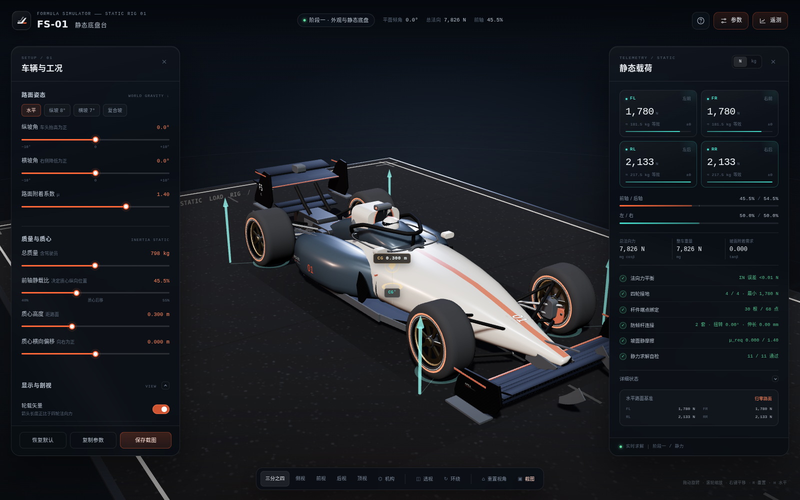
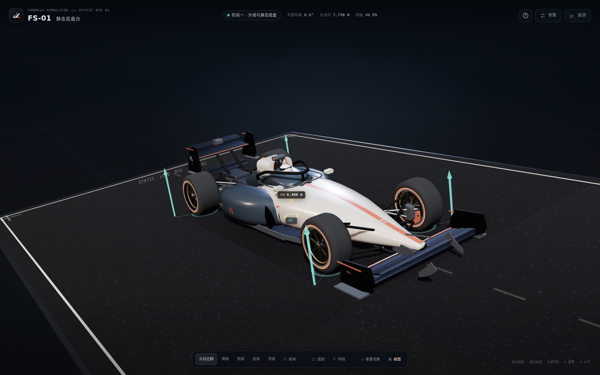
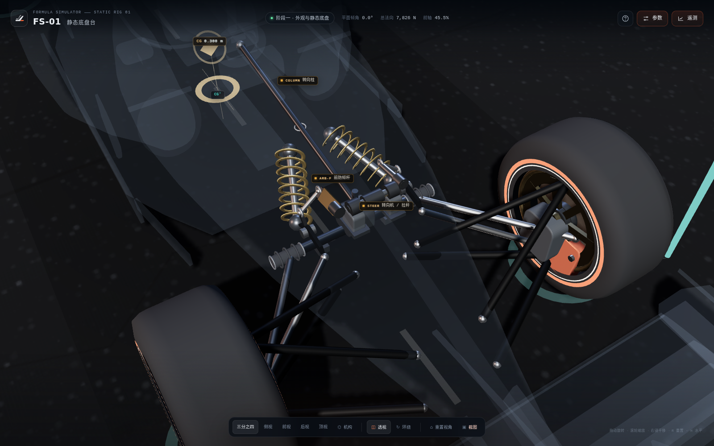
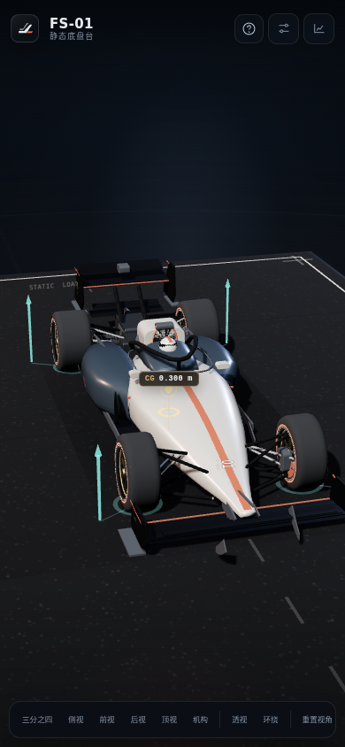

# Formula Simulator · FS-01 静态底盘台

阶段一交付：一个可离线运行、可交互调参的方程式赛车静态底盘演示。当前版本 `0.1.0`。入口是仓库根目录的 [`index.html`](index.html)，Three.js r149 已内嵌，不依赖网络、构建环境或本地服务器，直接用浏览器打开即可。



## 本期完成内容

阶段一的目标是建立“车—路面—静态载荷”的完整静态链路，并让外观与机构足以辨认和检查。本次交付包含：

- 程序化生成的现代开轮单座方程式赛车外观：鼻锥、单体壳、座舱、Halo、侧箱、发动机盖、进气口、前后多元素翼、底板、扩散器、四个外露车轮、轮毂、制动盘与卡钳。
- 可整体倾斜的路面试验台：纵坡和横坡独立调整，路面基向量、重力方向和四轮接触状态一致更新。
- 四角等效轮心弹簧支撑的静力求解：在水平与倾斜路面上计算四角法向载荷、轴荷分配、车体静态姿态和悬架行程。
- 前后双横臂、推杆/拉杆、摇臂、弹簧—阻尼器；前轴有转向机、转向柱、左右转向横拉杆，后轴有差速器、左右半轴与 CV 接头。杆件端点与车轮立柱、车体硬点逐帧绑定。
- 前后横向扭杆式防倾杆：扭杆通过左右轴承固定在车体上，两端各有一根同向伸出的杠杆臂，连接杆把臂端接到摇臂上的独立吊耳。其中一根杠杆臂（本模型为右臂）为扁平弹簧钢叶片，绕自身纵轴旋转改变弯曲刚度，对应 0–100% 硬度调节。
- 参数实时调整：质量、质心纵向/横向位置、质心高度、轴距、前后轮距、轮胎半径、前后轮心刚度、前/后防倾杆硬度、静态前轮转角、路面倾角与附着系数。
- 遥测面板：四角载荷 N / kg 等效、前后与左右分配、总法向力、坡面附着需求、相对水平路面的载荷变化、防倾杆等效刚度、扭杆扭转角、叶片转角、计算残差与静态校核。
- 三维工程标注：四轮法向载荷箭头、质心世界竖直投影线、接触印迹、地面参考网格；剖视时可显示转向、传动与前/后防倾杆的机构标注。
- 模型自检、参数持久化、当前参数 JSON 复制、PNG 截图导出；桌面和移动端自适应。

## 快速开始

最简单的方式是直接双击 `index.html`。页面必须通过本地文件加载，不需要服务器。

如果希望从源码构建或在本机预览：

```bash
# 仅重新生成自包含的 index.html，无第三方构建依赖
node tools/build.mjs

# 可选：本地静态服务器（不是运行应用的必需条件）
npm run dev
# 打开 http://127.0.0.1:8731
```

构建脚本把 `src/index.template.html`、`src/styles.css`、`src/js/*.js` 和 `vendor/three.min.js` 合并成单个 `index.html`。这也是入口文件体积约 800 KiB 的原因。

## 页面操作

| 操作 | 说明 |
| --- | --- |
| 拖动画面 | 环绕观察，滚轮缩放，右键或 Shift+拖动平移 |
| 1 – 5 | 切换三分之四、侧视、前视、后视、顶视相机 |
| M / 机构按钮 | 依次进入转向、传动、前防倾杆、后防倾杆剖视；自动打开透视并收起两侧面板 |
| R | 重置相机；竖屏移动端会回到竖屏取景 |
| H | 路面恢复水平 |
| X / F / G | 车身剖视 / 轮载矢量 / 质心与重力线 |
| 参数面板 | 路面姿态、质量与质心、尺寸、悬架与防倾杆、显示开关、截图与参数复制 |
| 遥测面板 | 四角载荷、轴荷分配、详细状态、静态校核、水平基准 |
| 竖屏手机 | 参数与遥测以抽屉面板打开，遮罩关闭 |

遥测面板可在 N 和 kg 等效之间切换；kg 值按 g = 9.80665 m/s² 换算，不是 kgf 的精确工程定义。

## 静力模型

### 坐标与路面

路面局部坐标采用 x 向前、y 沿路面法向、z 向右。路面姿态由纵坡角 θ 与横坡角 φ 定义；重力始终沿世界竖直方向。四轮接地点位于路面平面，轮心在路面上方一个轮胎半径处。坡度为正时车头抬起，横坡为正时右侧降低。

### 法向力与力矩

设路面法向与竖直方向的夹角为 β，车重为 mg，则四轮法向载荷总和为：

```
ΣN = mg cosβ
```

在车体参考点上，过质心的竖直重力线与路面相交于 P。四角法向力必须同时满足：

```
ΣN_i = mg cosβ
Σx_i N_i = mg cosβ · P_x
Σz_i N_i = mg cosβ · P_z
```

P 相对于质心地面投影的位置由上式和质心高度 h_CG 决定。上坡时 P 向低处偏移，因此轮载向后轴转移；右侧降低时 P 向右偏移，轮载向右侧转移。

### 四角弹簧与姿态闭合

每个角用一个等效轮心弹簧支撑，弹簧刚度为 k_i。车体相对路面的升沉 h、俯仰 p、侧倾 r 与四个角法向高度满足小角度关系：

```
N_i = N_i0 − k_i (h + x_i p − z_i r)
```

其中 N_i0 是设计姿态下的静态角重量：由前轴静载比确定前后轴载荷，再由质心横向位置在每个轴的轮距内分配左右。把弹簧力代入上面三个平衡方程，会得到关于 h、p、r 的三元一次方程组；解出姿态后即可得到四个角载荷。因此，倾斜路面上的四角分配同时受质心位置、路面姿态和前后轮心刚度影响，而不是简单地把总载荷按固定比例分开。

### 防倾杆

前后防倾杆各是一根横向扭杆。扭杆两端的杠杆臂朝同一侧伸出，臂端通过连接杆连到摇臂吊耳。左右悬架同向等量运动时，扭杆在轴承中自由转动，不产生扭转；单轮跳动或车体侧倾时，两臂反向转动，扭杆受扭并对左右轮心施加等大反向的附加力：

```
F_arb,L = −k_a · t · r
F_arb,R = +k_a · t · r
```

其中 t 为该轴轮距，r 为车体侧倾角，k_a 为防倾杆的等效轮心刚度。它只进入侧倾方程，等效侧倾刚度为：

```
K_arb = k_aF · t_F² + k_aR · t_R²
```

页面的 0–100% 硬度按可调臂叶片绕纵轴转角映射：100% 为叶片立起（强轴受弯，最硬），0% 为叶片放平（弱轴受弯，最软）。静力求解使用等效轮心刚度，不计算叶片本身的梁弯曲应力；叶片几何转角用 θ = arccos√(硬度) 表示，使叶片在视觉上的宽面方向与设定一致。

在水平路面上，解仍严格回到设计姿态：p = r = h = 0，角载荷等于按质心位置分配的静态角重。自检中的“水平前轴荷比等于质心设定”“水平横向力矩等于 mg·z_CG”和“水平路面防倾杆无预载”分别检查这些性质。

### 坡面附着需求

重力在路面内的切向分量为 mg sinβ，法向分量为 mg cosβ。页面按各轮载荷比例分配切向力，给出均匀附着需求：

```
μ_req = tanβ
```

当 μ_req 超过设定附着系数时，遥测中的“坡面静摩擦”检查会变为警告。这个简化不校核坡面偏航、四轮独立附着和轮胎侧偏；阶段三接入轮胎模型后会替换。

### 设计边界

阶段一明确不包含车体六自由度动态积分、弹簧阻尼动态、轮胎滑移与侧向力、空气动力、差速器内部扭矩分配和路肩。转向仅驱动前轮、转向横拉杆与轮胎姿态，不产生侧向力；内侧弹簧、摇臂和防倾杆在普通视图中隐藏，切换到“透视”后可见。前后防倾杆以等效轮心刚度计入静力方程；杠杆臂在 x–y 平面内转动，连接杆的 z 向跨距由臂端与摇臂吊耳的横向偏置固定，求解按固定杆长在投影平面内闭合，但不计算叶片梁弯曲应力、扭杆惯量或动态侧倾。双横臂和推杆仍为端点绑定的视觉运动学，未强制刚体杆长约束；阶段二会用共享几何模块替换。姿态方程采用小角度线性化（实际静态姿态通常远小于 1°），这是首版静力模型的一部分。

## 自检与验收

页面内置 11 项静力自检，结果显示在“？”模型说明和遥测检查区。打开模型说明或完成尺寸重建后会重新运行：

1. 水平总法向力 = mg。
2. 水平前轴荷比 = 质心设定。
3. 水平横向载荷跟随质心。
4. 倾斜总法向力 = mg cosβ。
5. 倾斜力矩平衡。
6. 上坡时载荷后移。
7. 右倾时载荷右移。
8. 转向不改变静态轮载。
9. 水平路面防倾杆无预载。
10. 防倾杆降低侧倾角。
11. 常规工况四轮保持接地。

界面还会实时显示法向力残差、力矩残差、四轮接触数量、杆件端点数、最大绑定偏差、防倾杆套数、扭杆扭转角与连接杆闭合误差；默认配置下 30 根连杆、68 个端点的最大绑定偏差为 0.000 mm，防倾杆连接杆的闭合误差约为 0.000 mm。

阶段一验收对照：

| 设计文档要求 | 本演示 |
| --- | --- |
| 外观与主要尺寸可辨识、可调整 | 程序化 F1 外观；轴距、前后轮距、轮胎半径可调 |
| 倾斜路面、质心与四轮静态位置 | 双轴倾斜台；轮心始终位于路面上方一个胎高 |
| 水平与倾斜路面静态轮载 | 四角弹簧 + 姿态闭合求解；水平/倾斜切换与水平基准对比 |
| 悬架杆件和车轮保持连接 | 逐帧端点绑定；剖视检查内部摇臂、弹簧、转向机、半轴与防倾杆 |
| 前后防倾杆的机构与静力作用 | 横向扭杆 + 同向杠杆臂 + 连接杆；叶片式硬度调节；等效侧倾刚度计入静力方程 |

## 截图与数据

- 左侧面板底部“保存截图”导出当前 3D 视角的 PNG，画布上会叠加标题、日期、四角载荷、总法向力、平面倾角和附着需求；不包含网页 UI。
- “复制参数”输出包含当前 setup 和静力摘要的 JSON。
- 参数保存在浏览器 localStorage 中；可在“恢复默认”中重置。




转向机构剖视：转向机、转向柱与左右转向横拉杆。



前防倾杆剖视：横向扭杆、叶片式杠杆臂和连接杆。


后防倾杆、差速器与半轴。


竖屏移动端的默认取景使用更长距离、更靠前的视角，以便完整看到赛车：



## 文件结构

```
index.html                 自包含入口（构建产物，可直接打开）
DESIGN.md                  项目设计文档
src/
  index.template.html      HTML 模板与控制面板结构
  styles.css               界面样式
  js/
    00-core.js             状态、坐标变换、静力求解、自检
    10-scene.js            Three.js 场景、路面、倾斜台、相机、力标注
    20-car.js              程序化车身、材质、贴花
    22-car-dynamics.js     车轮、悬架、弹簧、防倾杆与更新循环
    30-ui.js               控件、遥测、自检、面板与移动端
    40-app.js              启动、状态编排、渲染循环、截图导出
vendor/
  three.min.js             Three.js r149（MIT）
  three.LICENSE
tools/
  build.mjs                单文件构建
  dev-server.mjs           可选本地静态服务器
docs/                      预览图片
```

修改源码后执行 `node tools/build.mjs` 重新生成 `index.html`。不要直接改 `index.html`，它会被构建覆盖。

## 已知限制与后续

首版是静态底盘和静态载荷工具，不是完整车辆动力学模拟器。下一阶段的优先级按 [DESIGN.md](DESIGN.md) 推进：

- 阶段二：车体六自由度、四角弹簧—阻尼器、前后防倾杆动态、悬架机构几何与共享运动学。
- 阶段三：四轮自转、后轴扭矩、轮胎侧偏/纵滑、摩擦饱和、前轮转向闭环。
- 阶段四：空气动力、压力中心与阻力，扩展调参和实时轮载显示。

当前额外限制：气动力、轮胎力、差速器内部扭矩分配和路肩均为零或未建模；路面是单一平面；双横臂与推杆不做刚体长度约束；防倾杆使用等效轮心刚度而不计算叶片梁应力；附着需求采用均匀分配假设；高倾角下若出现车轮负法向载荷，界面会提示模型超范围并将显示载荷截断为 0。

## 第三方

Three.js r149，MIT License。版权声明随库保留在 `vendor/three.min.js` 和 `vendor/three.LICENSE` 中。
