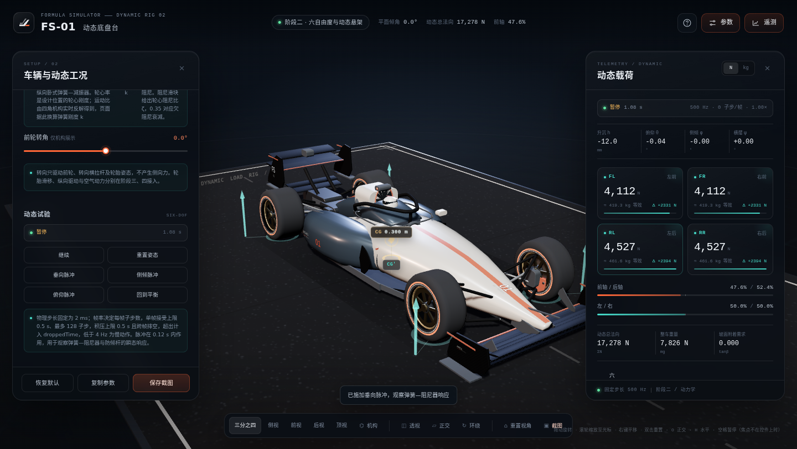
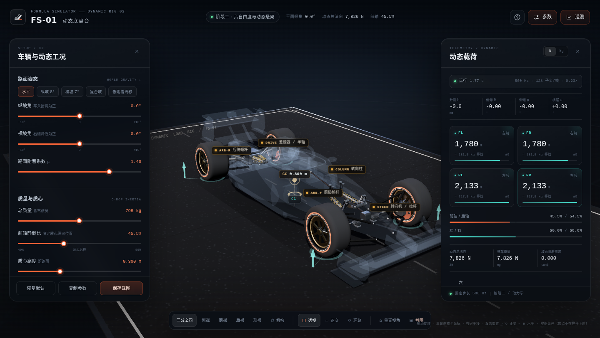
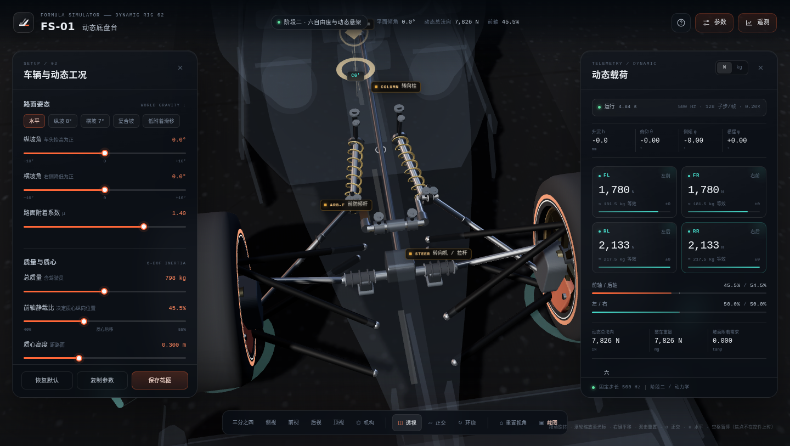
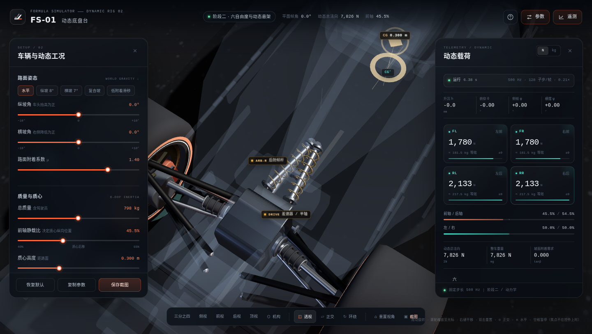
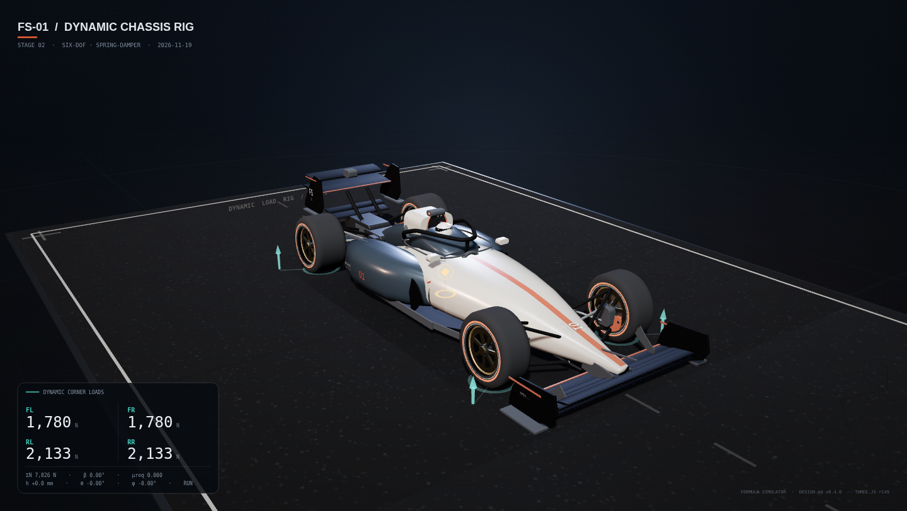
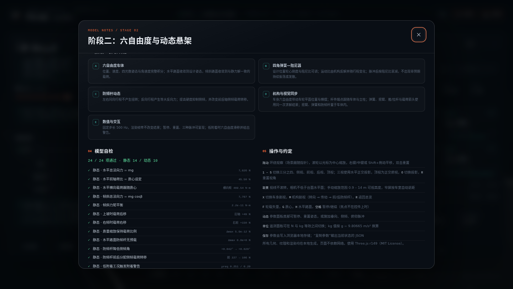

# Formula Simulator · FS-01 动态底盘台

阶段二交付：一个可离线运行、可交互调参的方程式赛车六自由度车身与动态悬架演示。当前版本 `0.4.0`。入口是仓库根目录的 [`index.html`](index.html)，Three.js r149 已内嵌，不依赖网络、构建环境或本地服务器，直接用浏览器打开即可。


0.4.0 的悬挂布置、共享力链路和包络验证见 [悬挂重构说明](docs/suspension-refactor.md)。

## 本期完成内容

阶段一建立了“车—路面—静态载荷”的链路；阶段二在此基础上加入时间维度，让车体在悬挂力、重力和接触摩擦作用下真实运动。本次交付包含：

- 车体六自由度：三个平移（纵移、横移、升沉）和三个转动（俯仰、侧倾、横摆），四元数姿态、角速度和位置均为积分状态。
- 四角不等长双横臂、前推杆/后拉杆、车内摇臂与纵向卧式弹簧—阻尼器：硬点实时反解车轮位姿、线圈长度和瞬时运动比；弹簧、阻尼器、摇臂和防倾杆均置于车体包络内，外部只保留叉臂、推/拉杆、横拉杆和后半轴等机构。
- 前后横向扭杆式防倾杆动态：按左右行程差产生等大反向的附加轮心力，参与车体侧倾、俯仰和升沉方程。
- 固定步长 2 ms 的半隐式欧拉积分：渲染帧率决定每帧执行多少个子步；低帧率按 0.5 s 积压跨帧排空，低于 4 Hz 进入慢动作，无法排空的输入计入 `droppedTime`。
- 倾斜平面上的切向库仑摩擦：静摩擦按法向载荷比例分配，维持坡面驻车；超过 `μΣN` 或已经滑移时施加动摩擦，允许车体在平面内纵移、横移和横摆。
- 动态试验：暂停/继续、重置姿态、回到平衡，以及垂向、侧倾、俯仰三种短脉冲，用于观察弹簧—阻尼器和防倾杆的瞬态响应。
- 动态遥测：四角法向载荷、车身姿态与角速度、四角行程与弹簧压缩、阻尼力、防倾杆力、固有频率、惯量、仿真时间与子步数。
- 车身、车轮、摇臂、推/拉杆、卧式弹簧—阻尼器、防倾杆连接杆和载荷箭头共享同一套动态姿态；平面运动时接地点、标注和地面阴影同步移动。低跳动转向拉杆把 ±25 mm 行程的前/后跳动转向控制在约 0.09°/0.03°。
- 24 项页面自检（14 项静力/边界 + 10 项动力学），以及 Node 静力 `50` 项、动力学 `104` 项、物理不变量 `31` 项检查和无头 Chrome 浏览器冒烟测试。
- 参数持久化、JSON 参数复制、PNG 截图导出；桌面和移动端自适应。

## 快速开始

最简单的方式是直接双击 `index.html`。页面通过本地文件加载，不需要服务器。

从源码构建、验证或预览：

```bash
# 重新生成自包含的 index.html，无第三方构建依赖
node tools/build.mjs

# 静力与动力学核心验证（Node，无第三方依赖）
npm test

# 分别运行
npm run test:core
npm run test:dynamics

# 物理不变量、运行时与自检专项
npm run test:invariants
npm run test:runtime

# UI 与 dev-server 边界（UI 需要 Chrome）
npm run test:ui
npm run test:dev-server

# 构建产物一致性（不写盘）
npm run build:check

# 审计基线（修复前失败清单；修复后应退出 0）
npm run audit:baseline

# 无头 Chrome 动态交互测试；未安装 Chrome 时自动跳过
npm run test:browser

# 悬挂包络、卧式布置、动态网格与力遥测一致性
npm run test:suspension

# 相机交互冒烟测试
npm run test:camera

# 重新生成 docs/ 下的预览截图（需要 Chrome）
npm run docs:capture

# 可选：本地静态服务器
npm run dev
# 打开 http://127.0.0.1:8731
```

构建脚本把 `src/index.template.html`、`src/styles.css`、`src/js/*.js` 和 `vendor/three.min.js` 合并成单个 `index.html`。这也是入口文件体积约 1.0 MiB（1,053,648 B）的原因。

Node 版本有两档约束。`package.json` 的 `engines.node` 为 `>=18`，该下限只覆盖非浏览器命令：`npm test`、`npm run test:core`、`npm run test:dynamics`、`npm run test:invariants`、`npm run test:runtime`、`npm run test:dev-server`、`npm run build:check` 与 Node 侧审计脚本。浏览器命令（`npm run test:ui`、`npm run test:browser`、`npm run test:suspension`、`npm run test:camera` 以及 `npm run audit` 的 browser 组）通过 CDP 连接 Chrome，依赖 Node 21+ 提供的全局 `WebSocket`；在 Node 18/20 上不能运行这些命令，也不能把 `engines >=18` 解读为浏览器测试的版本下限。当前验证环境为 Node 24.22.1 与 Chrome 156。

## 页面操作

| 操作 | 说明 |
| --- | --- |
| 拖动画面 | 环绕观察；滚轮以光标为中心缩放；右键、中键或 Shift+拖动平移；双击重置 |
| 1 – 5 | 三分之四、侧视、前视、后视、顶视；三视和顶视为正交投影 |
| O / R / H | 切换透视与正交 / 重置相机 / 路面恢复水平 |
| X / F / G | 车身剖视 / 轮载矢量 / 质心与重力线 |
| M | 依次进入转向、传动、前防倾杆、后防倾杆剖视 |
| 空格 / I | 暂停或继续仿真 / 施加垂向脉冲 |
| 参数面板 | 路面姿态、质量与质心、显示、尺寸、悬架与转向、动态试验 |
| 遥测面板 | 姿态条、四角载荷、轴荷与左右分配、动态校核、详细状态、水平基准 |
| 竖屏手机 | 参数与遥测以抽屉面板打开，遮罩关闭 |

遥测面板可在 N 和 kg 等效之间切换；kg 值按 g = 9.80665 m/s² 换算，不是 kgf 的精确工程定义。

## 动态试验

参数面板底部的“动态试验”区提供以下操作：

| 操作 | 作用 |
| --- | --- |
| 暂停 / 继续 | 冻结或恢复固定步长积分。暂停时仍可观察当前姿态和载荷 |
| 重置姿态 | 把车体放回当前路面和参数下的静力平衡姿态，并清零速度 |
| 垂向脉冲 | 在质心处施加 0.12 s 的向下 6800 N 力，激励升沉和俯仰 |
| 侧倾脉冲 | 在右侧 0.90 m 处施加 0.12 s 的向下 4200 N 力，激励侧倾 |
| 俯仰脉冲 | 在车身参考点前方 0.95 m 处施加 0.12 s 的向下 6200 N 力；绕质心力臂为 `offset − cgBody`，零姿态俯仰力矩为 −6880.45 N·m |
| 回到平衡 | 重置姿态并运行 2 s，让阻尼把残余振动衰减掉 |

“低附着滑移”路面预设把纵坡、横坡都设为 10°，附着系数设为 0.20。此时 `μ_req = tan(β) ≈ 0.251 > 0.20`，静摩擦不足以维持驻车，车体会沿坡面滑移；这是阶段二用来验证平面三个自由度和动摩擦分支的工况。滑到试验台边界时平面速度归零，警告区提示边界状态。



## 动力学模型

### 坐标与姿态

路面局部坐标取 x 向前、y 沿法向、z 向右。重力始终沿世界竖直方向；路面倾斜后，重力在路面坐标中的分量随倾角变化。车体参考点取设计状态下的台面中心，质心在车体坐标中为 `(x_CG, h_CG, z_CG)`。

车体姿态用四元数 `q` 表示，从车体坐标旋转到路面坐标；显示用欧拉角按

```
R = R_y(yaw) · R_z(pitch) · R_x(roll)
```

提取。正俯仰抬车头，正侧倾压低右侧，正横摆使车头向左。平动状态以质心 `r_CG` 为积分变量，车身参考点由 `p = r_CG − R(q)c` 派生（`c` 为质心在车体系中的位置）；两者之间的偏移自动计入力矩。

### 六自由度刚体方程

记车体质量 `m`、质心转动惯量 `I_CG`、车体角速度 `ω`，每个接地点受到法向力 `N_i`、切向摩擦力 `f_i` 和脉冲力 `F_impulse`：

```
m · dv/dt = m·g + Σ N_i e_y + Σ f_i + F_impulse
I_CG · dω/dt + ω × (I_CG ω) = Σ (r_i − r_CG) × F_i
```

四元数按 `q̇ = ½ q ⊗ (0, ω)` 推进，每步归一化。当前惯量由与质量、轴距、轮距和车高相关的等效长方体估算，默认约 `I_xx = 265`、`I_yy = 1417`、`I_zz = 1250 kg·m²`；尚未提供独立的惯量滑块。

### 四角弹簧—阻尼器

每个角由完整的双横臂—推/拉杆—摇臂—卧式弹簧/阻尼器机构支撑。前轴推杆从下部轮架斜向上进入单体壳，后轴拉杆从上部轮架斜向下进入变速箱承载结构。弹簧、阻尼器、摇臂和防倾杆均在车体内，普通视图隐藏、剖视显示。硬点固定，车体位姿给定后，以轮架三个转角为未知量反解上下横臂、横拉杆和接地点约束，得到轮架位姿、推/拉杆端点、摇臂角与线圈长度 `L(δ)`；运动比不再是输入，而是机构在当前位置的导数：

```
i(δ) = −dL/dδ
F_s  = k_s (L − L_ref) + c_s L̇
N_i  = F_s · i(δ) + F_arb,i
```

设计位置的轮心刚度 `k_w` 与运动比 `i_0` 决定线圈刚度、轴端阻尼和预载：

```
k_s = k_w / i_0²
c_s = c_w / i_0²,  c_w = 2 ζ √(k_w · m_i)
L_ref = L_0 + N_0 / (k_s · i_0)
```

默认前/后轮心率 140 / 160 N/mm、阻尼比 0.35 / 0.38，机构反解得到的设计运动比约 1.27 / 1.01，对应线圈刚度约 87 / 158 N/mm。这里的 `i` 定义为弹簧行程变化量与轮跳之比，和把轮跳放在分子上的文献定义互为倒数。运动比随行程和转向连续变化，遥测面板给出当前前后轴的平均值；弹簧压缩量就是画面中线圈长度的变化，两者由同一次反解产生。力链路回退时通过 `coilSource` 明确标记；轮架与接地点投影回路面后重新闭合摇臂，力、遥测和画面使用同一个投影长度，不再混用估算长度与未收敛画面。

### 防倾杆

前后防倾杆各是一根横向扭杆。左右摇臂同向等量运动时，扭杆在轴承中自由转动，不产生扭转；左右行程不同时，扭杆受扭，对左右轮心施加等大反向的附加力。设左右车体法向位移之差为 `Δ = δ_L − δ_R`，等效轮心刚度为 `k_a`：

```
F_arb,L = −k_a · Δ
F_arb,R = +k_a · Δ
```

两根防倾杆的力都不改变整车法向合力，只改变左右载荷分配和侧倾力矩。0–100% 硬度按叶片绕纵轴转角映射：100% 为叶片立起（强轴受弯，最硬），0% 为叶片放平（弱轴受弯，最软）；页面使用等效轮心刚度，不计算叶片梁应力。

### 接触、驻车与滑移

四轮接触点始终位于倾斜平面内，轮心在平面上方一个轮胎半径处。接触法向力取悬挂力在零以下截断：

```
N_contact,i = max(0, N_i)
```

当车体平面速度近似为零、且维持平衡所需的切向力不超过 `μΣN_contact` 时，按各轮法向力的比例分配静摩擦：

```
f_i = −F_t · N_contact,i / ΣN_contact
```

并把平面速度和横摆角速度约束为零。这个分配与静力模型中的重力线投影一致，因此倾斜路面上的动态平衡载荷会收敛到 `computeStatic` 的解。当所需切向力超过容量，或车辆已经在运动时，改用动摩擦 `μN_contact` 沿接地点滑移速度的反方向作用，车体可以在平面内纵移、横移和横摆。

这个切向模型只负责坡面驻车和滑移，不产生轮胎侧偏力、纵滑力和回正力矩；阶段三会用完整的轮胎滑移模型替换。车体平面位置被限制在试验台范围内（x = ±4.2 m，z = ±2.6 m），越界时平面速度归零并给出提示。

### 数值积分

积分采用固定步长 `1/500 s` 的半隐式欧拉格式：先由当前状态计算力和力矩，更新线速度、角速度，再用新速度更新位置和四元数。渲染循环使用时间累加器：单帧接受的实际耗时上限为 0.5 s，每帧最多执行 128 个 2 ms 子步；积压上限为 0.5 s，可跨帧排空，超过上限的输入才丢弃并计入 `droppedTime`；低于 4 Hz 时进入慢动作（2 Hz 实测约 0.512×），固定步长意义下的状态一致性不变。

## 静力参考

阶段一的静力求解器仍保留，作为设计基准、初始姿态、动态自检和“水平路面基准”的数据源。水平路面上动态解严格回到设计姿态：四角载荷等于由质心位置分配的静态角重量，总法向力等于 `mg`。倾斜路面上，动态解与静力解的法向载荷差小于 1 N（默认参数和 ±10° 包线内实测最大约 0.8 N），总法向力收敛到 `mg cosβ`。

## 自检与验收

页面内置 24 项自检：14 项静力/边界检查和 10 项动力学检查。打开“？”模型说明时重新运行动力学自检；参数变化后遥测中的“动态自检”显示最近一次结果。

静力检查：

1. 水平总法向力 = mg。
2. 水平前轴荷比 = 质心设定。
3. 水平横向载荷跟随质心。
4. 倾斜总法向力 = mg cosβ。
5. 倾斜力矩平衡。
6. 上坡时载荷后移。
7. 右倾时载荷右移。
8. 质量缩放保持载荷比例。
9. 水平路面防倾杆无预载。
10. 防倾杆降低侧倾角。
11. 防倾杆前后分配侧倾载荷转移。
12. 低附着工况触发附着警告。
13. 超包线输入触发负载荷保护。
14. 常规工况四轮保持接地。

动力学检查：

1. 水平路面动态解收敛到设计姿态。
2. 倾斜路面动态解收敛到静力解。
3. 四角载荷非负且有限。
4. 垂向脉冲后按阻尼衰减。
5. 防倾杆抑制侧倾。
6. 固定步长结果可重复。
7. 渲染帧率不改变物理状态。
8. 低附着工况下六自由度滑移。
9. 低速驻车。
10. 滑移不反向。

Node 验证覆盖静力核心 50 项、动力学核心 104 项和物理不变量 31 项（含机构闭合、接触点、运动比、齿条标定与线圈行程一致性）；浏览器测试覆盖暂停/继续、脉冲、低附着滑移、重置、几何重建、阻尼参数和模型说明列表，另有 45 项 UI 可访问性与求解展示检查。`npm run test:suspension` 进一步按真实网格检查内部件包络、卧式倾角、普通/剖视可见性，以及 18°转向叠加脉冲和 3.20/3.70/3.90 m 轴距重建时的杆件闭合和画面—力遥测一致性。默认配置下 30 根连杆、68 个端点；悬架杆长偏差 0.000 mm，横拉杆长度偏差 0.000 mm。

阶段二验收对照：

| 设计文档要求 | 本演示 |
| --- | --- |
| 车体六自由度 | 位置、速度、四元数、角速度完整积分；平面运动与横摆可被低附着工况激励 |
| 四角弹簧—阻尼器 | 设计位置轮心刚度与阻尼比可调；运动比由机构反解并随行程变化；脉冲响应按阻尼比衰减 |
| 前后防倾杆动态 | 左右行程差驱动等大反向力；硬度改变侧倾峰值和前后载荷转移 |
| 悬架运动学与视觉 | 同一次机构反解驱动车轮位姿、摇臂、线圈长度、推/拉杆端点和力；±25 mm 行程闭合误差 < 10⁻⁵ mm；内部件通过真实网格包络检查 |
| 物理时间语义 | 固定 2 ms 步长；单帧接受 ≤0.5 s、每帧 ≤128 子步、积压 ≤0.5 s 跨帧排空；超出丢弃并计 `droppedTime`；低于 4 Hz 为慢动作（2 Hz 约 0.512×） |
| 倾斜路面与静力一致性 | 静力/动力学联合验证；倾斜载荷差 <1 N，总法向收敛到 mg cosβ |
| 数值稳定与可复现 | 120 组随机参数工况无 NaN/负法向载荷；相同输入 bit-identical |

## 截图与数据

- “保存截图”导出当前 3D 视角的 PNG，画布叠加标题、日期、四角动态载荷、总法向力、车身姿态和仿真状态；不包含网页 UI。
- “复制参数”输出包含当前 setup、动态摘要和仿真状态的 JSON。
- 参数保存在浏览器 localStorage 中；可在“恢复默认”中重置。
- 页面自检和动力学测试的结果可以直接通过 `window.FSApp.getSnapshot()`、`window.FSApp.runDynamicSelfTests()` 读取，供无头测试使用。
- `window.FSApp.getSuspensionPackaging()` 返回内部件顶点包络、关键硬点、弹簧轴线倾角、推/拉杆类型和普通/剖视可见性，供装配检查使用。




转向机构剖视：转向机、转向柱与左右转向横拉杆。


前防倾杆剖视：横向扭杆、叶片式杠杆臂和连接杆。



后防倾杆、差速器与半轴。





竖屏移动端的默认取景使用更长距离、更靠前的视角，以便完整看到赛车：


页面自检列表（14 项静力 + 10 项动力学）：



## 文件结构

```
index.html                 自包含入口（构建产物，可直接打开）
DESIGN.md                  项目设计文档
src/
  index.template.html      HTML 模板与控制面板结构
  styles.css               界面样式
  js/
    00-core.js             状态、坐标变换、共享车体截面、静力求解、自检
    03-suspension.js       共享悬挂硬点、轮架反解、摇臂闭合与齿条标定
    05-body-dynamics.js    六自由度刚体、弹簧—阻尼器、防倾杆、摩擦与积分
    10-scene.js            Three.js 场景、路面、倾斜台、相机、力标注
    20-car.js              程序化车身、材质、贴花
    22-car-dynamics.js     车轮、悬架、弹簧、防倾杆与更新循环
    30-ui.js               控件、遥测、自检、面板与移动端
    40-app.js              启动、状态编排、渲染循环、截图导出
vendor/
  three.min.js             Three.js r149（MIT）
  three.LICENSE
tools/
  build.mjs                单文件构建
  test-core.mjs            静力核心验证（Node）
  test-dynamics.mjs        动力学核心验证（Node）
  test-physics-invariants.mjs 物理不变量验证（Node）
  test-runtime.mjs         帧时间、几何代际、自检与资源验证（Node）
  test-dynamics-browser.mjs 动态交互冒烟测试（headless Chrome，自动跳过）
  test-suspension-packaging.mjs 悬挂包络与动态网格一致性（headless Chrome）
  test-camera.mjs          相机交互冒烟测试（headless Chrome，自动跳过）
  test-ui-browser.mjs      UI 可访问性与求解展示测试（headless Chrome）
  test-dev-server.mjs      dev-server 路径与集成测试（Node）
  browser-runner.mjs       Chrome/CDP 启动、清理与严格模式
  check-build.mjs          index.html 与源码一致性检查
  capture-docs.mjs         预览截图生成（headless Chrome）
  dev-server.mjs           可选本地静态服务器
  audit/                   修复前审计脚本与 0.2.0 基线
docs/                      预览图片
```

修改源码后执行 `node tools/build.mjs` 重新生成 `index.html`。不要直接改 `index.html`，它会被构建覆盖。

## 已知限制与后续

阶段二的悬架力已经由机构几何驱动，但仍是单簧上质量的简化模型，不是完整车辆动力学模拟器。当前明确不包含：

- 轮胎侧偏、纵滑、摩擦椭圆和回正力矩；切向库仑摩擦只用于驻车/滑移。
- 后轴驱动扭矩、差速器内部转速约束和四轮自转动力学。
- 空气动力、压力中心和空气阻力。
- 非簧载质量、车轮离地和重新接触；法向力在零处截断，车轮视觉上仍保持接地点。
- 叶片梁应力、扭杆惯量、连接杆弹性、悬架衬套和杆件柔性。
- 阻尼速度采用瞬时运动比乘等效轮心速度的近似，不是线圈长度对完整车身姿态与速度的全导数。
- 独立可调的惯量张量、阿克曼转向和侧偏转向闭环；转向只驱动机构，不产生轮胎力。

按 [DESIGN.md](DESIGN.md) 的优先级，后续阶段为：

- 阶段三：四轮自转、后轴扭矩分配、轮胎侧偏/纵滑、摩擦饱和、前轮转向闭环。
- 阶段四：空气动力、压力中心与阻力，扩展调参和实时轮载显示。

## 第三方

Three.js r149，MIT License。版权声明随库保留在 `vendor/three.min.js` 和 `vendor/three.LICENSE` 中。
